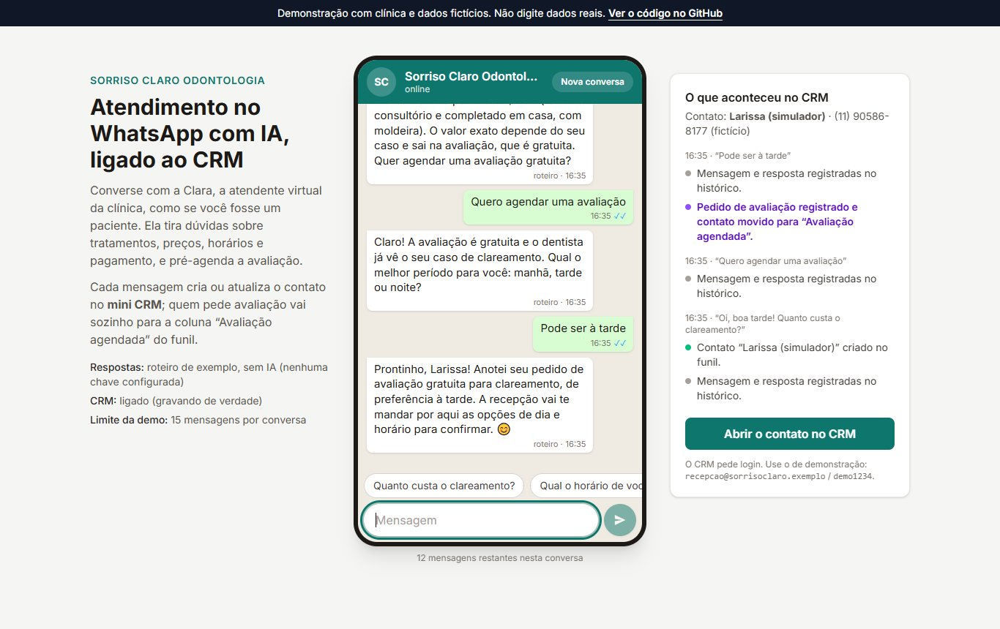
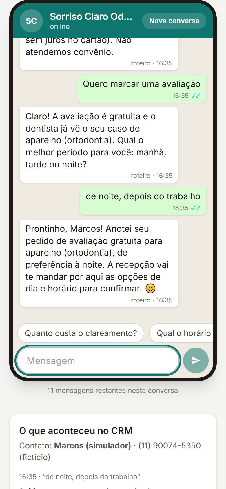
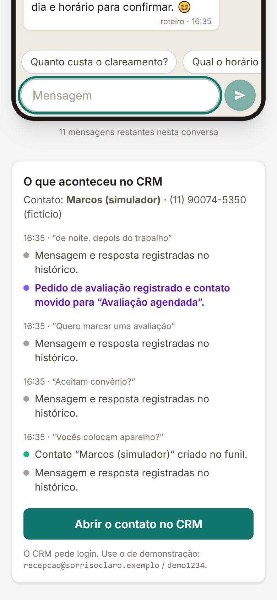
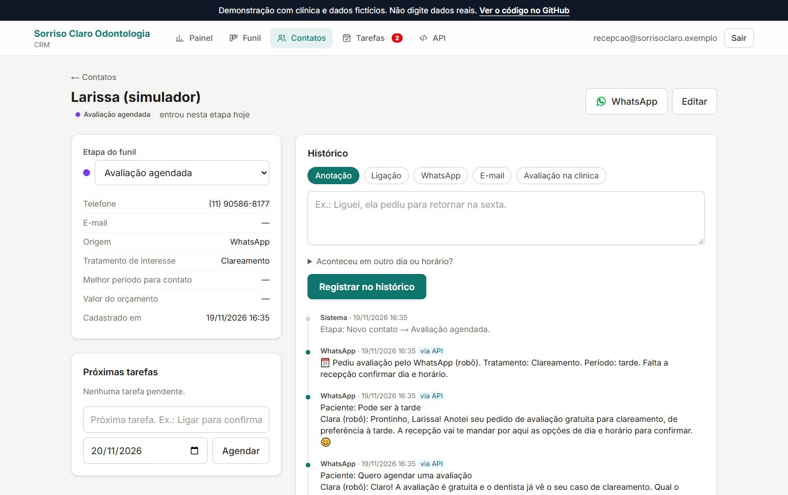
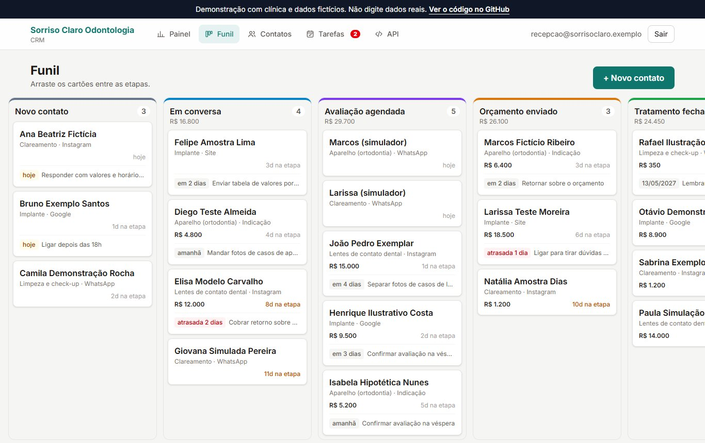

# Atendimento no WhatsApp com IA, ligado ao CRM

> ⚠️ **Projeto de demonstração.** A clínica "Sorriso Claro Odontologia", os preços, os pacientes e os telefones são **fictícios**.
> Todas as páginas mostram uma faixa avisando disso e não são indexadas pelo Google.
> Não digite dados reais na demo.

Robô de atendimento para o WhatsApp de negócios pequenos. Ele responde na hora as perguntas que a recepção mais recebe
(serviços, preço "a partir de", horário, endereço, pagamento), **pré-agenda a avaliação** e passa para a equipe o que
não deve resolver sozinho (dor, remarcação, reclamação). Cada conversa entra no **mini CRM** ([demo 2](https://github.com/dotenorio/demo-mini-crm)):
o contato é criado ou encontrado pelo telefone, as mensagens vão para o histórico e quem pede avaliação vai sozinho para a coluna
"Avaliação agendada" do funil.

Como a API oficial do WhatsApp é paga e exige aprovação da Meta, a demo pública tem um **simulador de WhatsApp na tela**:
você conversa como se fosse o paciente e vê, ao lado, o que foi gravado no CRM. A ligação com o WhatsApp de verdade
(webhook da WhatsApp Cloud API) está pronta e documentada abaixo, mas é opcional.

| Conversa no computador, com o que foi gravado no CRM |
|---|
|  |

| Celular | Celular: o que foi gravado | Contato no CRM | Funil do CRM |
|---|---|---|---|
|  |  |  |  |

## O problema

Em clínica, consultório e escritório pequenos, a recepção passa o dia respondendo as mesmas perguntas no WhatsApp,
muitas vezes fora do horário, e quem pergunta preço às 22h só recebe resposta no dia seguinte (quando já fechou com outro).
E o que foi conversado fica perdido no celular da recepção, sem ninguém saber quem pediu avaliação e não foi atendido.

## A solução

1. **Responde na hora, 24 h**, com as informações do próprio negócio (preços "a partir de", horários, endereço, pagamento, perguntas frequentes). Nunca inventa preço ou serviço: tudo sai de um arquivo de configuração.
2. **Pré-agenda a avaliação**: pergunta o tratamento de interesse e o melhor período; a recepção confirma dia e horário. (Ligar a uma agenda de verdade, como Google Agenda, fica para um projeto real.)
3. **Passa para a equipe** dor forte, urgência, remarcação, cancelamento, reclamação e qualquer pedido de "falar com alguém", e deixa uma anotação no CRM.
4. **Grava tudo no CRM**: cria o contato (ou acha pelo telefone), registra cada troca de mensagens no histórico, preenche o tratamento de interesse e move para "Avaliação agendada" quando o paciente pede.
5. **Funciona com ou sem IA**:
   - **com a chave da API do Claude**, entende perguntas escritas de qualquer jeito, conversa de forma natural e segue as regras da clínica;
   - **sem chave**, responde por um roteiro de regras (palavras-chave), com custo zero. O roteiro também é a rede de segurança do modo IA: se a API falhar ou a cota do dia acabar, o robô continua respondendo.

## Como funciona

```
Paciente ──► WhatsApp (Meta) ──► /api/whatsapp/webhook ─┐
                                                        ├─► motor: IA (Claude) ou roteiro ─► resposta
Visitante ──► simulador na tela ──► /api/simulador ─────┘            │
                                                                     └─► mini CRM (/api/v1): contato, histórico, etapa
```

- O simulador e o webhook passam pelo **mesmo motor** e pela **mesma gravação no CRM**. O que a demo mostra é o que roda no WhatsApp.
- A IA não grava nada sozinha: ela devolve um JSON validado (`resposta`, `acao`, `tratamento`, `periodo`) e **o nosso código** decide o que gravar no CRM. Uma resposta fora do formato é descartada e o roteiro responde no lugar.
- O webhook não tem banco próprio: para lembrar a conversa, lê as últimas mensagens do histórico do contato no CRM.

## Custos e limites da demo pública

A chave da API do Claude **fica só no servidor** (variável de ambiente); o navegador nunca a vê. Para a demo aberta não gerar custo:

| Limite | Padrão | Variável |
|---|---|---|
| Mensagens por conversa no simulador | 15 | `LIMITE_MENSAGENS_CONVERSA` |
| Mensagens por IP por dia | 40 | `LIMITE_MENSAGENS_IP_DIA` |
| Respostas com IA por dia (por servidor); depois disso, o roteiro responde | 300 | `LIMITE_IA_DIA` |
| Tamanho de cada mensagem | 500 caracteres | — |
| Mensagens anteriores enviadas à IA como contexto | 12 | — |

A conversa do simulador é uma ficha assinada (HMAC): o visitante não consegue trocar o contato do CRM nem zerar o contador.
Os contadores ficam na memória do servidor, então valem por instância da Vercel. Também vale definir um **limite de gasto mensal no console da Anthropic**.

## Ligar no WhatsApp de verdade (opcional)

Usa a **WhatsApp Cloud API**, a API oficial da Meta. É preciso uma conta no Meta for Developers e um número aprovado; a Meta cobra pelas conversas conforme a tabela de preços dela.

1. Em [developers.facebook.com](https://developers.facebook.com), crie um app do tipo **Business** e adicione o produto **WhatsApp**.
2. Anote o **Phone number ID** do número e gere um **token de acesso permanente** (usuário do sistema no Business Manager, com a permissão `whatsapp_business_messaging`). O token temporário da tela de testes expira em 24 h.
3. Em **App settings → Basic**, copie o **App Secret** (serve para conferir que as chamadas vêm mesmo da Meta).
4. Defina as variáveis na Vercel: `WHATSAPP_PHONE_NUMBER_ID`, `WHATSAPP_TOKEN`, `WHATSAPP_APP_SECRET` e `WHATSAPP_VERIFY_TOKEN` (um texto aleatório que você inventa).
5. Em **WhatsApp → Configuration → Webhook**, informe a URL `https://SEU-DOMINIO/api/whatsapp/webhook` e o mesmo `WHATSAPP_VERIFY_TOKEN`. Depois, assine o campo **messages**.
6. Mande uma mensagem para o número. A resposta chega pelo WhatsApp e a conversa aparece no CRM.

O que o webhook já faz: confere a assinatura `X-Hub-Signature-256`, responde 200 na hora e processa depois (para a Meta não reenviar),
ignora mensagens repetidas, responde texto e avisa educadamente quando recebe áudio, foto ou figurinha.
Num cliente real, use `SIMULADOR=false` para tirar o simulador do ar.

## Stack

- **Next.js 16 (App Router) + TypeScript + Tailwind CSS 4**, pronto para a Vercel
- **API do Claude** (SDK oficial `@anthropic-ai/sdk`) com saída estruturada validada por **zod**; modelo padrão `claude-opus-5-5`, trocável por `CLAUDE_MODELO`
- **WhatsApp Cloud API** (Meta) por webhook, opcional
- **Mini CRM** (demo 2) pela API HTTP dele
- **Vitest** para testes, **ESLint** e **GitHub Actions** (lint, tipos, testes e build a cada push)

### Decisões técnicas

- **Um arquivo por cliente.** Serviços, preços, horários, perguntas frequentes, o que vai para a equipe e o tom da atendente ficam em [`src/config/atendimento.ts`](src/config/atendimento.ts). O prompt da IA e o roteiro sem IA são montados a partir dele, então os dois nunca discordam.
- **IA sugere, o código decide.** A IA responde num formato fixo (JSON validado por zod, com tratamentos e períodos limitados aos da configuração). Gravar no CRM e mover de etapa é sempre o nosso código.
- **Sem IA também funciona.** O roteiro de regras responde de graça e entra no lugar da IA em qualquer falha (chave inválida, limite de uso, resposta fora do formato, recusa).
- **Esforço baixo na IA.** Conversa de atendimento não precisa de raciocínio longo: `effort: "low"` responde mais rápido e gasta menos. O prompt fixo vai marcado para cache.
- **Troca automática de modelo** quando a resposta é recusada pelos filtros de segurança da API (`fallbacks: "default"`), em vez de deixar o paciente sem resposta.
- **Sem banco próprio.** O simulador guarda o estado numa ficha assinada; o webhook usa o histórico do CRM como memória da conversa. Menos peças para manter.
- **CRM fora do ar não derruba o atendimento.** A falha aparece no painel e no log, e o paciente continua sendo respondido.

## Dados pessoais e LGPD

- A chave da IA e as credenciais do WhatsApp e do CRM ficam só no servidor.
- As mensagens enviadas para a IA vão sem telefone; só o primeiro nome do perfil e o texto da conversa.
- O webhook recusa chamadas sem a assinatura da Meta.
- O robô não dá diagnóstico nem orientação de tratamento, e manda urgências para a equipe.
- As páginas pedem para não ser indexadas por buscadores.

Num projeto real ainda é preciso definir com o cliente: aviso ao paciente de que está falando com um robô (a Clara já se apresenta como atendente virtual),
prazo de guarda das conversas e como atender pedidos de exclusão (no CRM).

## Como rodar localmente

Precisa de Node.js 22 ou mais novo.

```bash
npm install
npm run dev
```

Abra <http://localhost:3000>. Sem nenhuma configuração, o robô responde pelo **roteiro de exemplo** e não grava em lugar nenhum.

Para ver a gravação no CRM, rode o [mini CRM](https://github.com/dotenorio/demo-mini-crm) em outra porta (`npx next dev -p 3001` na pasta dele)
e crie um `.env.local` aqui:

```bash
CRM_API_URL=http://localhost:3001
CRM_API_CHAVE=demo-chave-publica-mini-crm
# Opcional: liga a IA
ANTHROPIC_API_KEY=sua-chave
```

O CRM pede login; o de demonstração é `recepcao@sorrisoclaro.exemplo` / `demo1234`.

### Comandos

| Comando | O que faz |
|---|---|
| `npm run dev` | Servidor de desenvolvimento |
| `npm test` | Testes (roteiro, prompt e formato da IA, gravação no CRM, ficha da conversa, limites, webhook e a rota do simulador) |
| `npm run lint` | ESLint |
| `npm run typecheck` | Checagem de tipos do TypeScript |
| `npm run build` | Build de produção |

## Como adaptar para outro cliente

Edite **só** o arquivo [`src/config/atendimento.ts`](src/config/atendimento.ts):

- `negocio`: nome, cor, endereço, horários e formas de pagamento;
- `demonstracao`: apague este bloco num cliente real (some a faixa de aviso);
- `atendente`: nome e tom da atendente virtual;
- `avaliacao`: como o negócio chama a primeira consulta ("avaliação", "consulta inicial", "visita técnica");
- `servicos`: cada serviço com preço "a partir de", uma descrição curta e as palavras que o cliente costuma usar;
- `periodos`, `perguntasFrequentes` e `encaminharParaEquipe`;
- `sugestoes`: os botões de pergunta pronta do simulador;
- `crm`: para qual etapa do funil vai quem agenda.

Exemplo para um escritório de advocacia:

```ts
avaliacao: { nome: "consulta inicial", descricao: "conversa de 30 minutos com o advogado, gratuita, para entender o caso" },
servicos: [
  { id: "trabalhista", nome: "Direito trabalhista", descricao: "rescisão, horas extras, acordos", palavras: ["demitido", "rescisao", "fgts"] },
  { id: "familia", nome: "Direito de família", descricao: "divórcio, pensão e guarda", palavras: ["divorcio", "pensao", "guarda"] },
],
encaminharParaEquipe: ["prazo processual vencendo", "audiência marcada", "andamento de processo já em curso"],
```

## Publicar na Vercel

1. Importe o repositório na Vercel.
2. Defina as variáveis de ambiente (veja [`.env.example`](.env.example)):
   - `CONVERSA_SEGREDO`, com 32 caracteres aleatórios ou mais (obrigatório);
   - `CRM_API_URL` e `CRM_API_CHAVE` do mini CRM publicado;
   - `ANTHROPIC_API_KEY` para ligar a IA (opcional) e, se quiser, os limites;
   - as variáveis `WHATSAPP_*` só se for ligar o WhatsApp de verdade.
3. Defina um limite de gasto no console da Anthropic.

> O `vercel.json` coloca as funções em São Paulo (`gru1`), perto do CRM.

## Limites conhecidos

- Não acessa uma agenda: o robô **pré-agenda** (anota tratamento e período) e a recepção confirma dia e horário. Integrar com Google Agenda ou o sistema da clínica é o próximo passo num projeto real.
- Só texto: áudio, foto e documento recebem um aviso pedindo para escrever.
- Os limites de uso ficam na memória de cada servidor. Com muito tráfego, troque por um contador compartilhado (Upstash Redis ou uma tabela no Supabase).
- A API do CRM não atualiza campos de um contato que já existe; o tratamento de interesse é preenchido na criação, e o período vai no texto do histórico.
- A IA pode errar o tom ou entender mal uma pergunta. Por isso ela só responde com as informações da configuração, nunca grava sozinha e manda os casos sensíveis para a equipe.
- O robô responde mensagens; não envia mensagens por conta própria (lembretes e confirmações exigem modelos aprovados pela Meta).

## Estrutura

```
src/config/atendimento.ts        dados da clínica, serviços, preços e regras (o que muda por cliente)
src/lib/motor/roteiro.ts         respostas sem IA (regras)
src/lib/motor/ia.ts              respostas com IA (API do Claude)
src/lib/motor/index.ts           escolhe IA ou roteiro, com cota diária
src/lib/crm.ts                   gravação no mini CRM e leitura do histórico
src/lib/whatsapp.ts              assinatura do webhook, leitura e envio de mensagens
src/lib/conversa.ts              ficha assinada da conversa do simulador
src/lib/limitador.ts             limites por IP, por conversa e de IA
src/app/Simulador.tsx            simulador de WhatsApp e painel do CRM
src/app/api/simulador/           rota do simulador
src/app/api/whatsapp/webhook/    webhook da WhatsApp Cloud API
tests/                           testes com Vitest
```

## Como foi feito

Desenvolvido com o Claude Code (IA) sob minha direção: defini o escopo e as regras de negócio, aprovei as decisões técnicas e revisei e testei o resultado. É a mesma forma como trabalho nos projetos de clientes.

---

Feito por [Fernando Tenório](https://github.com/dotenorio) como projeto de portfólio.
